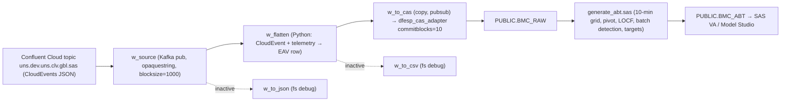

# Case Study: CandF Bioreactor UNS Stream → ESP → CAS (Viya 2026.08)

Source project: `C:\Git\martinoschuetz\projects\CandF` (full session context: `SESSION_CONTEXT.md` there).

## Architecture

## Debugging timeline (what failed, in order)
1. **Kafka auth / meta topic errors on Confluent Cloud.** Fix: `disableespmetaconsumer=true`, explicit `kafkaconsumergroupid`, `urlhostport=localhost_31415`, clean `kafkaglobalconfig`.
2. **No history replayed.** The group had committed offsets. Fix: reset the offsets with a script while the project is stopped (or use a new group).
3. **CAS schema mismatch.** `BMC_RAW.id` was DOUBLE, but ESP sends int64. Fix: re-create the table with `PROC FEDSQL` (`id BIGINT`).
4. **`java.io.EOFException` after ~17.5k events.** Fix: `blocksize=1000` (Kafka) + `commitblocks=10` (CAS).
5. **Wrong logs analyzed.** The ESP Studio download returned operator logs. Fix: use the ESP server pod log.
6. **Deployment.** Git import wasn't configured in Studio. Fix: REST POST with the JSON wrapper, which led to the MCP tool `esp_deploy_project`.

## Data facts (verified 2026-09-24)
- `BMC_RAW` held 90,635 rows. **100 % `tag_quality='True'`.** Production data had no bad-quality noise.
- Producer omits CloudEvents `specversion`, so parse permissively.
- The simulator publishes only ~2 h on weekdays from ~08:20 UTC. Outside that window the topic is silent, which looks like "ESP receives nothing".

## Lessons for agents
- Verify claims against data before you quote numbers. An earlier claim of a "1:6 bad-quality ratio" was **wrong**: it was inferred from a README's optional Filter window and never measured. Always run a `GROUP BY` on the real table.
- Count batches from data (glucose-spike rule in the ABT) instead of extrapolating events per batch.
